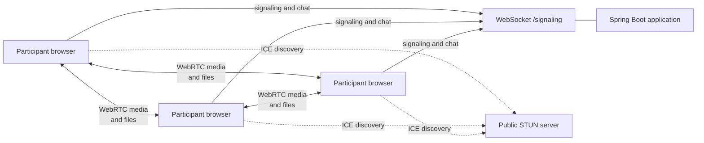

# Alap

Alap is a browser-based group meeting application built with Spring Boot and
WebRTC. It provides peer-to-peer audio/video, screen sharing, in-call chat, and
peer-to-peer file sharing. The backend is used for room membership and WebRTC
signaling; it does not relay meeting media.

## Features

- Room links generated from the `room` query parameter
- Camera and microphone controls
- Full-mesh group video calls
- Screen sharing through WebRTC track replacement
- In-call text chat through the signaling WebSocket
- Peer-to-peer file transfer through WebRTC data channels
- Docker support

## System architecture



The browser clients form a full mesh: every participant maintains one
`RTCPeerConnection` for every other participant. The signaling server stores
only in-memory room membership and forwards targeted offers, answers, ICE
candidates, chat messages, and participant events. Audio/video and file bytes
remain in the browser-to-browser WebRTC connections.

See [System Architecture](docs/system-architecture.md) for component
responsibilities, connection sequencing, deployment boundaries, and scaling
considerations.

## Connection flow

1. The client reads `room` from the URL or generates an eight-character room ID.
2. The client requests camera and microphone access and opens
   `/signaling?room=<roomId>`.
3. The server assigns a WebSocket session ID, adds the session to the room, and
   broadcasts join/leave events.
4. Clients exchange SDP offers/answers and ICE candidates through the server.
5. After negotiation, media flows directly between browsers. Chat uses the
   signaling channel, while files use a WebRTC data channel.

## Project structure

```text
src/
├── main/
│   ├── java/com/ricky/Alap/
│   │   ├── AlapApplication.java       # Spring Boot entry point
│   │   ├── config/WebSocketConfig.java
│   │   └── handler/SignalingHandler.java
│   └── resources/
│       ├── application.properties
│       └── static/
│           ├── index.html
│           ├── style.css
│           └── webrtc.js
└── test/
    └── java/com/ricky/Alap/
        └── AlapApplicationTests.java
```

## Requirements

- Java 21
- Maven 3.9+ (or the included Maven Wrapper)
- A browser with WebRTC support

## Run locally

```bash
./mvnw spring-boot:run
```

Open [http://localhost:8081](http://localhost:8081) in a WebRTC-compatible
browser. Share the generated room URL with other participants.

To build and test:

```bash
./mvnw clean test
```

## Run with Docker

```bash
docker build -t alap .
docker run --rm -p 8081:8081 alap
```

Then open [http://localhost:8081](http://localhost:8081).

## Configuration

The server listens on port `8081` by default:

```properties
server.port=8081
```

The signaling endpoint accepts all origins for the current development setup.
For production, restrict allowed origins and serve the application over HTTPS
so browsers can use secure WebSocket connections.

## Current limitations

- Full-mesh WebRTC causes connection and bandwidth usage to grow with the
  number of participants.
- A TURN server is not configured, so some restrictive networks may fail to
  establish peer connections.
- Room state is held in server memory and is lost when the application stops.
- There is no authentication or authorization for room access.
- File transfers are limited to 15 MB per file in the browser client.
