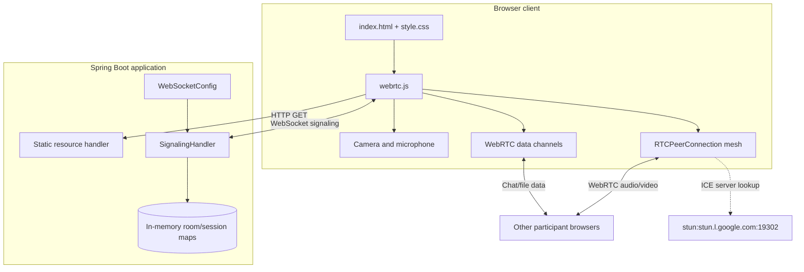
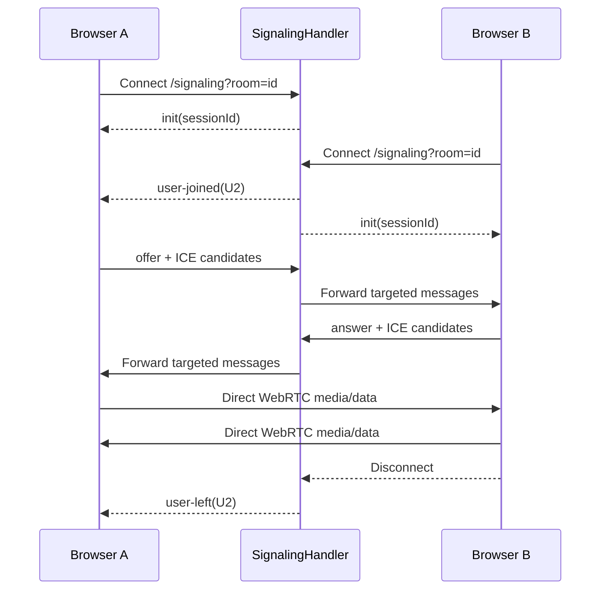

# System Architecture

Alap is a single Spring Boot application serving a static browser client and a
WebSocket signaling endpoint. Meeting media is deliberately kept out of the
server path: browsers negotiate direct WebRTC connections with one another.

## Logical view

## Component responsibilities

| Component | Responsibility |
| --- | --- |
| `index.html` | Defines the meeting UI, controls, video grid, chat panel, and file input. |
| `style.css` | Provides the meeting layout and interaction styling. |
| `webrtc.js` | Owns room discovery, media permissions, peer connections, screen sharing, chat, file transfer, and participant cleanup. |
| `WebSocketConfig` | Registers the `/signaling` WebSocket endpoint. |
| `SignalingHandler` | Tracks sessions by room, sends lifecycle events, and forwards targeted signaling messages. |
| STUN server | Helps clients discover public network candidates during ICE negotiation. |

## Runtime sequence

## Data paths

- **Audio/video:** Captured with `getUserMedia`, added to each peer
  connection, and sent directly between browsers.
- **Screen sharing:** `getDisplayMedia` obtains a screen track; each peer
  connection replaces its video sender track until sharing stops.
- **Chat:** A chat message is sent as a targeted JSON message over the
  signaling WebSocket to each connected peer.
- **Files:** The sender creates a `fileTransfer` data channel, sends metadata,
  then sends 16 KB binary chunks. The client limits files to 15 MB.
- **Signaling:** SDP offers, answers, and ICE candidates are routed by session
  ID and are accepted only for sessions in the sender's room.

## Deployment boundaries

The Docker image builds the application with Maven and runs the packaged JAR on
port `8081`. The same process serves the static client and handles WebSocket
signaling. For production, terminate TLS in front of the application, use
`wss://`, restrict WebSocket origins, configure a TURN service, and provide
shared room state if multiple application instances are deployed.

## Scaling and security considerations

The full-mesh topology requires each browser to maintain `N - 1` connections,
so connection count and upload bandwidth increase quickly as rooms grow. A
selective forwarding unit (SFU) would be the next architectural step for
larger rooms.

Room IDs currently act as the only room address, and the server has no
authentication or authorization layer. Room access controls, input validation,
origin restrictions, HTTPS, and TURN credentials should be added before
production use.
